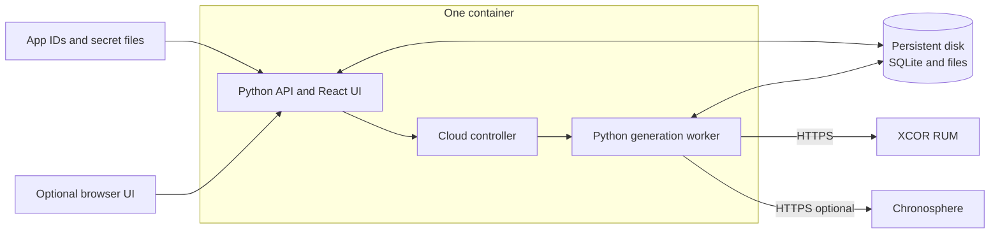
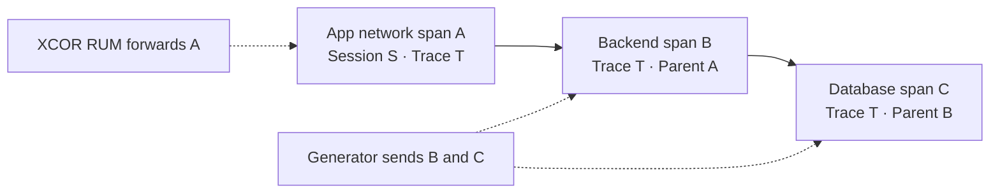

# Session Generator architecture and hosting overview

*Shared infrastructure review   13 November 2026*

We need one always-on Linux host to run Session Generator continuously. The application already packages its UI, API, cloud controller and generation worker in one container. Persistent storage and private administrative access are the main hosting requirements.

### What the service does

The generator creates synthetic web, native Android and native iOS sessions for shopping, banking and travel. It builds SDK-shaped payloads and sends them over HTTPS to XCOR RUM and, optionally, matching backend traces to Chronosphere. It does not run real phones, browsers or business services for each visit.



### How it runs without a browser

Setup collects the app IDs and optional keys. The controller builds the run configuration, starts one stream and supervises its worker. The existing UI remains available for interactive jobs; cloud generation does not depend on a browser being open.

SQLite and files retain run history, visitor state and operator choices outside the container. Keep one host and one application replica; this is not a shared-database or horizontally scaled deployment.

Kafka: The generator models Kafka work as spans; no Kafka broker is required for this service. Simulated database and cache operations also do not require those business systems to be deployed.

## How sessions and backend traces connect

A session contains many actions. Each network request can have its own distributed trace. The generator creates the app network span and its backend spans with matching trace context.



The session ID is not used as the trace ID. Matching trace IDs group the request, while parent span IDs preserve the call tree. XCOR RUM forwards the app span through Network Spans Forwarding; Chronosphere joins it to the backend spans.

The app, forwarded request domains and destination retention must be configured. App IDs and keys alone do not establish that integration. An API acknowledgement confirms acceptance, not storage or dashboard visibility.

### Inputs for unattended generation

| Input | Purpose |
| --- | --- |
| Web, Android and iOS app IDs | Supply each platform to include; leave unused IDs blank. |
| Chronosphere tenant and API token | Optional pair that enables linked backend traces. |
| Web Symbol Upload key | Optional source maps for original JavaScript files and lines. |

Defaults are 10 total sessions per minute, shared equally across enabled platforms, with varied visitors, journeys and the UI Production baseline error mix. The rate is an average. Generation continues until paused or stopped.

No scenario JSON file is required. Setup writes ordinary settings to a protected environment file and keys to private files mounted into the container. A company secret manager can supply those same files.

Without the optional symbol key, web sessions still contain real captured compiled stacks. The automatic maps cover the generator’s own web bundles; native Android and iOS symbol upload is not part of this setup.

## Hosting and first startup

| Requirement | Starting point |
| --- | --- |
| Compute | One Linux VM with Docker Engine, Compose and Python 3. Start at 2 CPU cores and 4 GiB RAM; this is a sizing suggestion, not a benchmark. |
| Persistent storage | Durable local disk at /srv/session-generator. Keep it through updates and protect backups; do not share SQLite between replicas. |
| Network and access | Outbound HTTPS to enabled destinations. Port 8000 binds to loopback; use authenticated access through an SSH tunnel or company private access. |
| Operations | Enable Docker at host boot. Assign an owner for updates, disk retention, backups and generation monitoring. |

From the repository on the provisioned host, build an immutable versioned image and run the setup prompts. Enter its image tag, the desired app IDs and any optional keys.

```sh
docker build -t "session-generator:$(git rev-parse --short=12 HEAD)" .
sudo python3 deploy/cloud/setup.py
sudo deploy/cloud/runner.sh check
sudo deploy/cloud/runner.sh start
sudo deploy/cloud/runner.sh status
```

The check generates 12 sessions locally with networking disabled. Start repeats that check, then begins live continuous traffic and optional source-map uploads. Neither build nor setup sends telemetry.

### Routine operation

Use runner.sh pause, resume or stop with the same sudo command prefix. Pause and stop persist across restarts. The controller applies bounded recovery to unexpected worker exits; delivery circuit-breaker failures require attention. Container restart is handled by Docker.

Monitor cloud status for achieved rate, delivery failures and acknowledgements as well as host health. /health only checks the process and database. Forced shutdown can interrupt pending deliveries; uncertain uploads are not replayed, so recovery is not lossless or exactly once.

This implementation has not been deployed to a company cloud host. The remaining rollout is to provision the host, enter destination inputs, start it, and verify sessions and linked traces in the destination dashboards.

See [Cloud setup and operations](cloud-runner.md) for detailed commands, updates, private UI access and limits, and the [repository overview](../README.md).
