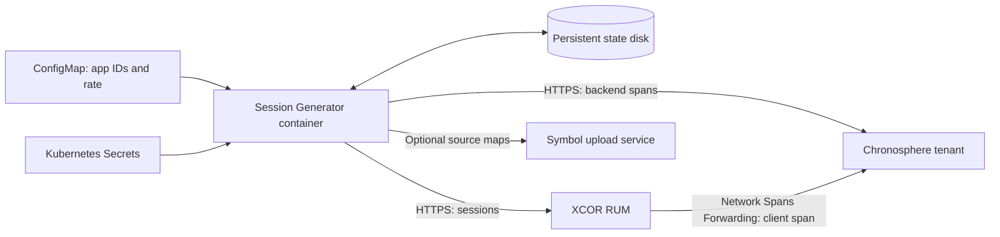

# Session Generator: deployment handoff

**Deploy one continuously running container with one persistent disk.** It generates synthetic web, Android and iOS sessions and optional matching backend traces. Configuration is app IDs and runtime keys; no scenario JSON, browser, emulator, Kafka broker or additional application service is needed. Kafka activity in generated traces is simulated.

The same image contains the UI, API, controller and generation workers. The headless controller starts when `SG_CLOUD_RUNNER=1`; the UI is optional and private.



## Inputs and ownership

| Owner supplies | Charles configures |
| --- | --- |
| Existing web, Android and/or iOS app IDs, names and US/EU ingest regions | Published image **digest**, namespace and registry pull access |
| Optional Chronosphere tenant + trace API token | ConfigMap and selected namespace Secret keys through SOPS/KSOPS |
| Optional web Symbol Upload token | Persistent disk, resource budget, egress and ArgoCD workload |
| Agreed traffic rate | Monitoring, backups, rotation and deployment ownership |

An ID enables its platform; blanks disable it. Distinct five-character IDs are required. Default traffic is **10 total sessions/minute**, equally weighted across enabled platforms, with the current Production baseline, including expected network failures. This is an average arrival rate; achieved throughput depends on resources and destination responses.

Sessions-only needs no ingestion API token. Adding `SG_CHRONOSPHERE_TENANT` and `SG_CHRONOSPHERE_TOKEN` together enables linked backend traces. Tenant inputs accept `tenant`, `tenant.chronosphere.io:443` or an HTTPS URL; the shared secret need not change. `SG_SYMBOL_UPLOAD_TOKEN` is optional and applies to web source maps, not native debug symbols. An invalid configured symbol credential blocks startup; omitting it keeps real compiled stack positions.

The [Kustomize package](../deploy/kubernetes/README.md) has one company overlay for these inputs and optional components with explicit Secret references. The repository template has blank IDs and an image placeholder; the downloadable release handoff already pins its image digest. Charles supplies the app IDs and infrastructure settings, then adds it to the existing ArgoCD configuration repository. Creating app forwarding rules and tenant retention policies remains separate.

## Build and publish the handoff image

The application repository's **Publish tested container** workflow is manually triggered on `main`; it does not deploy infrastructure or generate live telemetry. Release only after the source commit's security and payload checks pass.

```sh
gh workflow run container.yml --repo Aissa-emb/Session-Generator --ref main
gh run list --repo Aissa-emb/Session-Generator --workflow container.yml --limit 5
gh run watch <run-id> --repo Aissa-emb/Session-Generator --exit-status
```

The workflow builds and tests Linux AMD64 and ARM64 images natively, then publishes the combined `ghcr.io/aissa-emb/session-generator:sha-<full-commit>` reference with an SBOM and build provenance. Its final job records the registry digest. Inspect the release and put the **digest**, not a moving tag, into Charles's GitOps image reference:

```sh
docker buildx imagetools inspect ghcr.io/aissa-emb/session-generator:sha-<full-commit>
```

Use `ghcr.io/aissa-emb/session-generator@sha256:<verified-digest>` and record its source commit. Confirm both architectures are listed and test the cluster's pull access. A public source repository does not automatically make its GHCR package public; use approved package visibility or existing registry pull credentials. Charles may mirror the tested image into the company registry, then pin that registry's verified digest. Package publication and company deployment are separate actions.

### Downloadable fallback

Each successful publication also creates a public GitHub release named `container-<first-12-commit-characters>`. It contains a Docker archive per architecture, checksums, scan results, `image-reference.txt` and `kubernetes-handoff.tar.gz`. The handoff overlay is already pinned to the published multi-architecture digest. If GHCR pull access is unavailable, Charles can download the appropriate archive and load it without registry credentials:

```sh
gh release download container-<short-commit> --repo Aissa-emb/Session-Generator \
  --pattern session-generator-linux-amd64.tar.gz --pattern SHA256SUMS-amd64.txt
sha256sum --check SHA256SUMS-amd64.txt
docker load --input session-generator-linux-amd64.tar.gz
```

Use `arm64` instead of `amd64` for ARM nodes. `docker load` prints the loaded tag: `session-generator:sha-<full-commit>-amd64`. A finite local check can run without networking or credentials:

```sh
docker run --rm --network none --read-only --cap-drop ALL --security-opt no-new-privileges \
  --tmpfs /tmp:rw,nosuid,size=256m,uid=10001,gid=10001,mode=700 \
  --tmpfs /var/lib/session-generator:rw,nosuid,size=1g,uid=10001,gid=10001,mode=700 \
  -e SG_WEB_APP_ID=web01 \
  session-generator:sha-<full-commit>-amd64 python -m server.cloud check --sessions 12
```

This command generates only a local fixture. For continuous Kubernetes operation, tag/push the loaded image to the approved company registry, set the overlay to that registry's verified digest, and deploy with the real ConfigMap/Secret inputs described below. The Docker archive contains one architecture; the GHCR reference carries the combined index and build attestations. Building, downloading and loading an image do not start live traffic.

## Hosting requirements

- **One replica, `Recreate`, persistent state at `/var/lib/session-generator`.** Start with a CSI block-backed 20 GiB filesystem PVC, preferably `ReadWriteOncePod`. No shared NFS/RWX state or autoscaling. Fence an old worker before forced replacement.
- **Initial allocation:** request 1 CPU/1 GiB, limit 2 CPU/4 GiB; measure before raising the rate. Nonroot UID/GID 10001, read-only root, dropped capabilities and no Kubernetes service-account token. A small `/tmp` emptyDir is included.
- **Outbound DNS and HTTPS:** app-specific US/EU XCOR RUM ingestion hosts; the selected tenant at `https://<tenant>.chronosphere.io/data/opentelemetry/v1/traces`; and `dsym-store.emb-api.com` if source maps are enabled. No public inbound endpoint is required. Use company egress controls, not fixed provider IP assumptions.
- **Direct HTTPS delivery in this release.** The company collector's port **4317 is OTLP/gRPC** and cannot be substituted for the current OTLP/HTTP sender. A central-collector route would need an explicit transport/routing change. Complete traces also require XCOR RUM forwarding to the same tenant with the matching request domains.
- **Treat the state volume and backups as secret-bearing.** The controller persists immutable plaintext credential snapshots in private mode-0600 files so active work can recover. Use approved encrypted disks/backups and restrict access. Kubernetes Secret environment injection is supported; mounting projected Secret symlinks directly as `*_TOKEN_FILE` is not. No tenant keys belong in the image or Git.

The configured `SG_RUNNER_REGION` is an operational label; dashboard geography still follows actual egress IP. Ingestion acknowledgement does not establish retained storage or dashboard visibility.

## Operations

Use the configured namespace in place of `<namespace>`:

```sh
kubectl -n <namespace> rollout status deployment/session-generator
kubectl -n <namespace> logs deployment/session-generator
kubectl -n <namespace> exec deployment/session-generator -- python -m server.cloud status
kubectl -n <namespace> exec deployment/session-generator -- python -m server.cloud pause
kubectl -n <namespace> exec deployment/session-generator -- python -m server.cloud resume
kubectl -n <namespace> exec deployment/session-generator -- python -m server.cloud stop
```

Pause/stop survive replacement; `resume` is explicit. Routine SIGTERM maintenance shutdown drains pending work and preserves the previous operator intent. Allow 90 seconds; forced termination can lose in-flight data. Recovery is not an exactly-once delivery guarantee.

For optional UI access, create an operator token inside the pod, store its one-time output in 1Password, then port-forward. This administrative token is separate from destination keys and is unnecessary for unattended generation.

```sh
kubectl -n <namespace> exec deployment/session-generator -- python -m server.admin create-token --name 'Cloud operator'
kubectl -n <namespace> port-forward deployment/session-generator 8000:8000
```

Keep `SG_REQUIRE_AUTH=1`; no `SG_AUTH_TOKEN` setting exists. No public Service is included. Any additional internal hostname must be explicitly allowlisted with `SG_ALLOWED_HOSTS`.

Kubernetes probes use `/livez` for local process responsiveness and `/readyz` for local readiness, with `Host: localhost`. Paused/stopped traffic and destination outages must not trigger liveness restart loops. Also monitor authenticated `/api/cloud/status` or the CLI: desired versus observed state, controller/worker freshness, achieved rate, acknowledgements, delivery errors and blocked startup. A healthy probe does not prove telemetry is arriving.

Rotate credentials through the existing secret workflow and replace the pod: bump the pod-template configuration revision or use a versioned Secret name. Retain old activation snapshots until dependent work drains. Same-name Secret updates alone do not restart the pod.

Monitor disk growth and set an operator retention policy. Historical runs, specs and credential snapshots can accumulate despite bounded live detail buffers. Never delete active/paused dependencies. For a simple consistent backup, perform a controlled maintenance shutdown, confirm all writers are gone, then snapshot/copy the complete state volume, including SQLite WAL files. Use a tested SQLite-consistent method for online backups. Protect and test restoring backups. Do not delete the PVC to recover a failed upgrade.

Rollback through GitOps to a known compatible image/config digest, preserving state. A previous image is not automatically compatible with a newer database schema; retain a consistent pre-upgrade backup and check schema compatibility first. ArgoCD may undo an imperative `rollout undo`.

## Deployment acceptance

Charles validates namespace access, Secret creation, image pull, nonroot fresh-volume ownership, mode-0600 tokens after pod replacement and single-writer storage behavior in the actual cluster. Application tests and local Kustomize rendering do not establish company KSOPS/KMS or CSI compatibility.

Start with an authorized low-rate run. Confirm sessions in each configured app, expected network failures, readable web stacks (resolved sources when a valid symbol key is configured), and a known trace ID joining the forwarded client span to its backend children. Then verify restart and pause/resume behavior and monitor a sustained run before increasing traffic.
